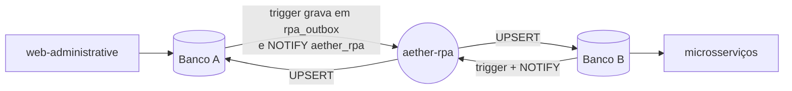

# Aether RPA

Worker de ETL bidirecional do [Aether](https://github.com/AetherGases), em Python, entre o **banco A** (`dbAether1Year`, cadastral/CRUD) e o **banco B** (`dbAether2Year`, core dos microsserviços), ambos PostgreSQL. O worker replica alterações detectadas via outbox + `LISTEN`/`NOTIFY`.

## Por que existe

O Aether usa dois bancos por regra de negócio: o [aether-web-administrative](https://github.com/AetherGases/aether-web-administrative) escreve o cadastro no banco A e os microsserviços Java ([ms-auth](https://github.com/AetherGases/aether-ms-auth), [ms-inventory](https://github.com/AetherGases/aether-ms-inventory)) trabalham no banco B. O RPA faz os dois enxergarem o mesmo cadastro, nos dois sentidos, sem chamadas HTTP entre os sistemas.



**Tabelas replicadas** (em ordem de chave estrangeira): `addresses`, `storage_files`, `permissions`, `plans`, `companies`, `permission_groups`, `units`, `sectors`, `permission_group_permissions`, `employees` e `subscriptions`.

## Requisitos

- Python 3.11+
- Dois bancos PostgreSQL acessíveis (schemas descritos em `DATABASE_A_STRUCTURE.md` e `DATABASE_B_SCTRUCTURE.md`)

## Instalação

```bash
pip install -r requirements.txt
```

## Variáveis de ambiente

Em produção, A e B costumam estar no **mesmo cluster PostgreSQL**, com credenciais compartilhadas e nomes de banco distintos (GitHub Environments / Secrets):

| Variável | Descrição |
| -------- | --------- |
| `POSTGRES_USER` | Usuário (banco **B**) |
| `POSTGRES_PASSWORD` | Senha (banco **B**) |
| `RPA_POSTGRES_USER` | Usuário dedicado do RPA no banco **A** (`rpa_aether`) |
| `RPA_POSTGRES_PASSWORD` | Senha do usuário dedicado do RPA no banco **A** |
| `POSTGRES_HOST` | Host do cluster |
| `POSTGRES_PORT` | Porta (ex.: `5432`) |
| `POSTGRES_SSLMODE` | Modo SSL libpq (ex.: `require`) |
| `POSTGRES_DB_FIRST_YEAR` | Nome do banco **A** (cadastral / primeiro ano) |
| `POSTGRES_DB` | Nome do banco **B** (core / segundo ano) |

O worker monta as URLs de conexão a partir dessas variáveis (`sslmode` na query string).

Para desenvolvimento local, ainda é possível definir URLs completas (têm precedência):

| Variável | Descrição |
| -------- | --------- |
| `RPA_DATABASE_A_URL` | URL libpq do banco A no host direto, sem pooler (opcional; tem prioridade sobre `DATABASE_A_URL`) |
| `RPA_DATABASE_B_URL` | URL libpq do banco B no host direto, sem pooler (opcional; tem prioridade sobre `DATABASE_B_URL`) |
| `DATABASE_A_URL` | URL libpq do banco A (opcional) |
| `DATABASE_B_URL` | URL libpq do banco B (opcional) |

Exemplo: copie `.env.example` e ajuste.

## Executar o worker

```bash
python -m src.worker
```

O processo é um **daemon de longa duração**: mantém conexões abertas com A e B, processa a fila e escuta novos eventos.

### Ciclo de vida

Pré-requisito: `rpa_outbox`, funções PL/pgSQL e triggers já instalados nos dois bancos pelo script `init-postgres/13-rpa-outbox-triggers.sql` do `aether-toolskit` (executado pelo owner do banco). O RPA não executa DDL.

1. **Drain inicial** — esvazia pendências (`processed_at IS NULL`) do outbox de A → B e de B → A, respeitando ordem de FK (pais → filhos no insert/update; filhos → pais no delete).
2. **Listen** — `LISTEN aether_rpa` nos dois bancos; a cada `NOTIFY`, drena o outbox da origem correspondente e replica para o destino.

Detalhes das tabelas e triggers: seção **RPA** em `DATABASE_A_STRUCTURE.md` (banco A) e `DATABASE_B_SCTRUCTURE.md` (banco B).

### Prevenção de loop

Conexões do RPA usam `application_name=aether-rpa`. Os triggers de outbox **ignoram** writes feitos com esse `application_name`, para que a replicação A→B (ou B→A) não gere novos eventos no banco de destino.

### Escrita no destino

Insert no destino usa **UPSERT** (`INSERT … ON CONFLICT` na PK) para re-sync idempotente. Update e delete seguem PK mapeada entre A e B.

## Estrutura do código

| Módulo | Papel |
| ------ | ----- |
| `src/definition.py` | Tipos, mapeamento A↔B, ordem de FK |
| `src/extractor.py` | Leitura no banco origem |
| `src/transformer.py` | Conversão de colunas A↔B |
| `src/driver.py` | Insert/update/delete no destino |
| `src/orchestrator.py` | Drain do outbox + `LISTEN` |
| `src/worker.py` | Conexões, entrypoint |

## Pontos de atenção

- **Use o host direto do Postgres (sem pooler).** `LISTEN/NOTIFY` não funciona atrás de um pooler em modo transação (caso do Neon). Por isso existem `RPA_DATABASE_A_URL` e `RPA_DATABASE_B_URL`, que têm prioridade sobre as demais.
- **`LISTEN` só vale após o commit.** O worker faz `commit` logo depois do `LISTEN`, porque o Neon encerra conexões ociosas "idle in transaction" após 5 minutos.
- **O RPA não executa DDL.** Outbox, funções e triggers são instalados pelo dono do banco com o `13-rpa-outbox-triggers.sql` do [aether-toolskit](https://github.com/AetherGases/aether-toolskit). A lista de tabelas de lá precisa acompanhar `TABLE_ORDER` e `table_name_b` em `src/definition.py`.
- **Diferenças A↔B tratadas no `transformer`:** o tipo de `installments` (booleano em A, inteiro em B), os status de funcionário (`ACTIVE`, `INACTIVE`, `IN_VACATION`) e o nome da tabela de permissões (`permissions` em A, `permission` em B).
- Para o contrato de colunas de cada banco, veja `DATABASE_A_STRUCTURE.md`, `DATABASE_B_SCTRUCTURE.md` (sim, com esse nome) e `docs/specs/2026-09-25-alinhamento-schema-rpa.md`.

## Contexto para agentes de IA

`AGENTS.md` e `AGENT_NOTES/` guardam instruções e notas de memória usadas por assistentes de código neste repositório (TDD com 100% de cobertura, confirmar decisões com quem pede). Quem contribui sem assistente pode ignorá-los.

## Deploy

A imagem (`Dockerfile`, Python 3.11) não expõe porta: é um daemon. `POSTGRES_PORT` e `POSTGRES_SSLMODE` têm padrão na imagem e o restante vem do Secret `aether-env` no EKS. Publicar uma **release** dispara o deploy pelo workflow compartilhado da organização ([.github](https://github.com/AetherGases/.github)).

## Testes

```bash
pytest tests/ -v --cov --cov-report=term-missing
```
